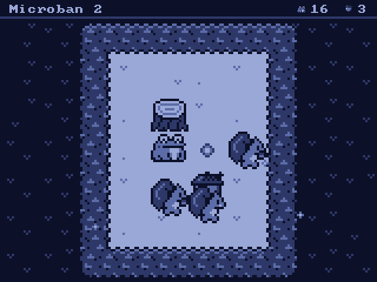
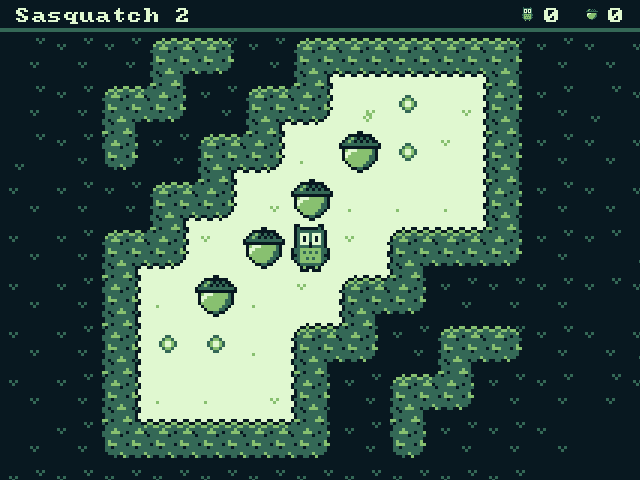
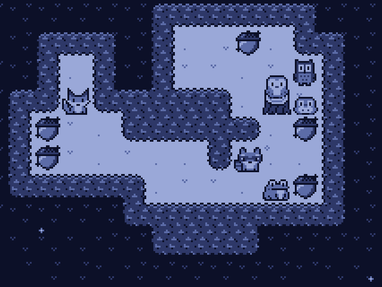
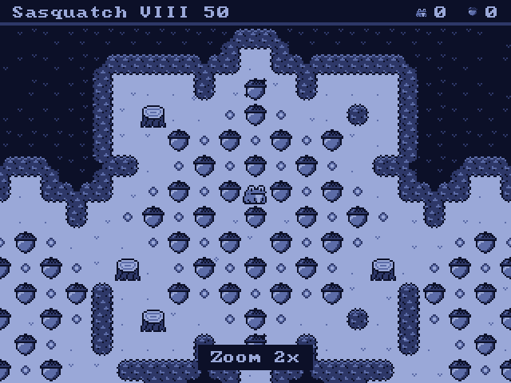
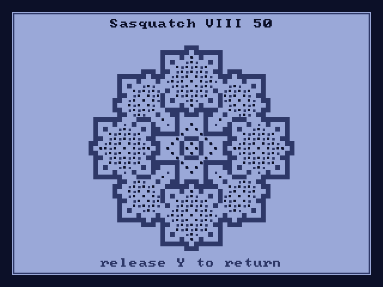
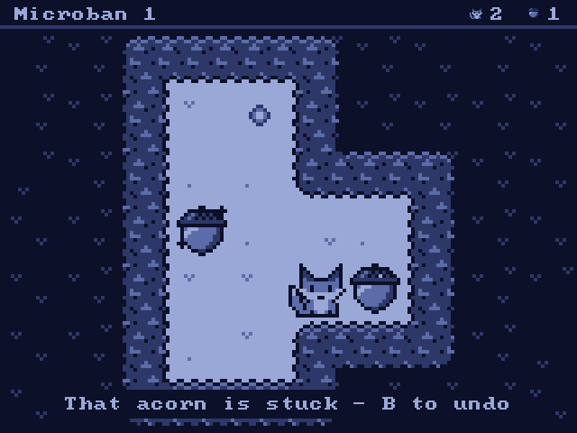
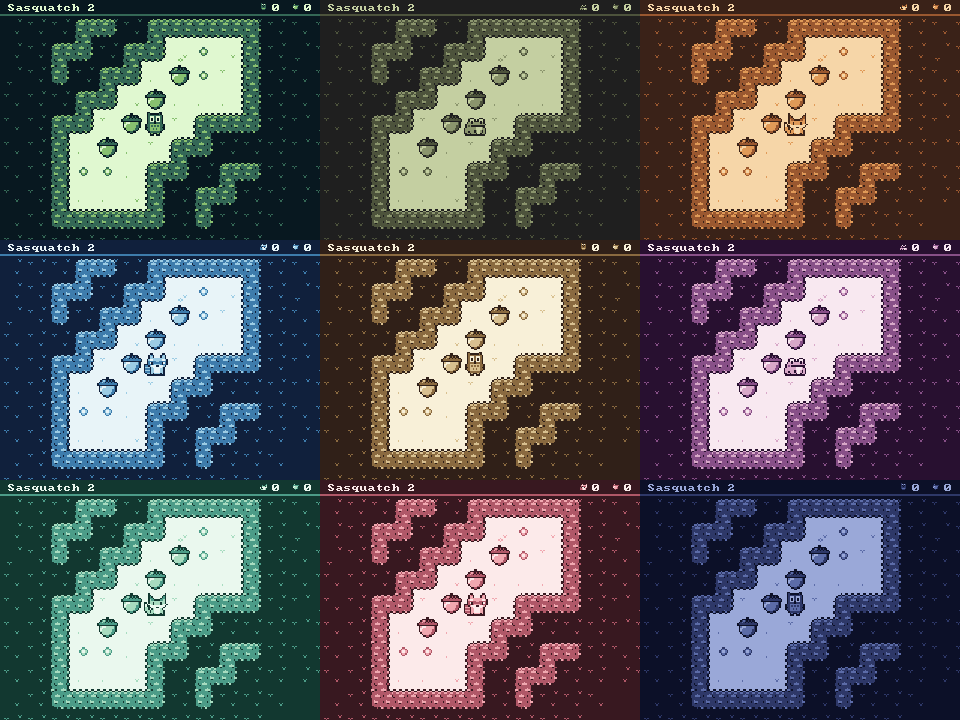
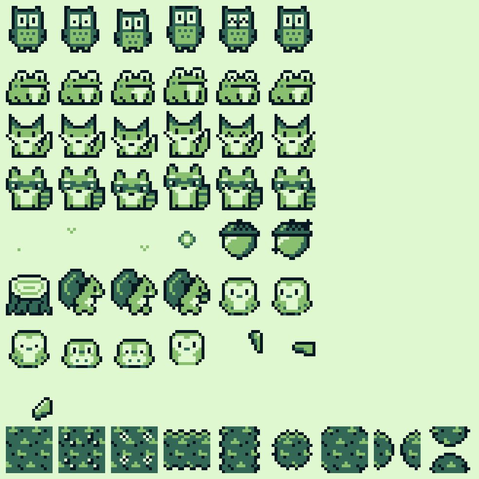

# Stumped

A Game Boy–style Sokoban set in a forest at night, for the **Miyoo Mini / Mini Plus running Onion OS**,
and in the browser at **[ReeveHunter.com/stumped](https://reevehunter.com/stumped/)** (with touch controls on phones and tablets).
You push acorns onto their spots as an owl, frog, fox or raccoon. When the last one lands, squirrels pop out
of the hedges and carry them home. It includes 1,093 puzzles by David W. Skinner and a generative
soundtrack that your moves play along with.

 
 


## Features (v0.67)

- **1,093 puzzles** by David W. Skinner: Microban I–IV (gentle, good for kids and beginners) and
  Sasquatch I–XII (harder). Each set is a plain text file in `levels/`.
- **Add your own level sets.** Any standard Sokoban `.txt` file (levels as `#@$.*+` rows, separated by
  blank or `;` lines) becomes a new set, with no size limit beyond the game's 64 x 64. On the Miyoo, copy it
  into `App/Stumped/levels/` on the SD card. On the web, choose *+ Add a level set* at the end of the *Level sets* list; the
  set is kept in your browser, and *Remove this set* in its menu in *Level sets* (**Select**, M on a keyboard,
  or the **⋯** button on its row with touch) removes it.
- **Make your own levels.** *Level maker* on the title screen (or *Level sets → My levels*), then **+**,
  opens the level maker: a 20 x 16 canvas.
  - **L1/R1** pick the tool: hedge, acorn, spot, your animal, eraser. **A** places it, or takes it away if
    it's already there (hold A and move to do a line; the first square decides which). **B** erases,
    **Select** undoes, **R2** redoes, **X** zooms out to see the whole canvas, **Start** is the menu: keep
    editing, test play, solve it for me, rotate, flip, help, clear everything (it asks first), and save and
    leave. The clearing lights up once your animal is inside a closed hedge.
  - Quiet help while you build: the acorn and spot counts sit in the corner (brighter when they don't
    match), and an acorn on a square it could never be pushed from onto a spot shakes, like a stuck
    acorn in the game: once when it gets stuck, then every few seconds once the counts match.
  - **Rotate** (a quarter turn) and **Flip** (left to right) in the menu; the level stays centred. Levels
    are centred wherever they're played, so there's nothing to move.
  - **Y** test-plays it. First it checks there's one animal, as many spots as acorns, and a closed hedge.
    Then a solver looks for the fewest moves possible (a few seconds at most); it tells you, or tells
    you it can't be solved. Big or busy levels may be too much for it, and then it's up to you.
  - **Solve it for me** (menu): if the solver finds a solution, the level gets its code without you
    playing it, and **Watch it** plays the fewest-move solution (any button takes over).
  - Pick one of your levels in *My levels* for its menu: *Edit*, *Play*, *Show its code* (once it has one)
    and *Delete* (press it twice).
  - **Solve it once and it gets a code** (*Show its code* on the level). Codes are letters and digits in
    rows of ten, split into groups of five, like `15DCE 447R4`, with a check at the end that catches typos.
    *Show its code* also draws it as a **QR code** that holds just the code (no web address): point a phone's
    camera at it to copy the code into a message. Long codes show the QR code and the text on separate
    pages (Y switches). Until it's solved, a level is a *Draft*. Editing a level makes it a new one, so it has to be solved again.
  - **Enter a code** (*My levels → +*) to add someone else's level. On the web you can type or paste it,
    or open a link like `reevehunter.com/stumped/#15DCE447R4...` (*Show its code* copies the code, or a
    link with X).
- **A clearing in the woods.** Walls are **hedges** that join into continuous bushes, with rounded outer
  corners, notched inner corners, leafy scalloped edges with a touch of moonlight, and the occasional
  berry or flower. A lone wall with nothing beside it is often a **tree stump**. Outside the clearing is
  darkness with tufts of dark grass that thin out the farther they are from the hedges, and **fireflies**
  drift over everything. Goals are small, quiet targets, and the ground has just a hint of grass.
- **Acorns and squirrels.** Push the acorns onto their spots; each one sparkles when it's home. When you
  solve a level, a squirrel runs out of the nearest hedge for every acorn, grabs it, and scampers back in.
- **Four animals**: Owl, Frog, Fox and Raccoon, chosen in Options. **Random** is the default, which gives
  you a new animal each level. They face the way they walk, blink, breathe and fidget while you think, and
  dance when you solve a level.
- **Real Game Boy pixels.** Everything is hand-drawn 16×16 art in 4 shades, shown at 1×, 2×, 3× or 4×
  (16–64 px tiles) with crisp square pixels. The game picks the largest size that shows the whole level.
  Menus, text and windows sit on the same 16 px grid. Tall levels that only fit with the status bar moved
  get a sidebar layout instead.
- **Zoom and map for big levels.** **L2/R2** zoom out and in (also in the pause menu); when zoomed past
  "whole level", the camera follows your animal. The zoom setting is remembered. **Hold Y** to see the whole
  level as a map. On 16 px tiles, corner brackets briefly point out the animal at the start of a level and
  after a long pause.

   

- **Stuck-acorn warning.** Push an acorn somewhere it can never get back out of (a corner, along a hedge
  with no spot, or locked in a 2×2 block), and it wobbles, plays a soft "uh-oh" and reminds you that B undoes.
  It only warns; it never stops a move. (The game works out the dead squares for each level when it loads.)

  
- **A barn owl drops by.** On about one level in four that has a stump, a barn owl swoops in some time
  after you start, lands on a stump and sits there a while, watching you as you move about, before flying off.
- **Fireflies keep you company.** After a few quiet seconds they drift over and circle your animal, then
  wander off again when you move.
- **Progress codes** carry which levels you've solved to another device (Miyoo, phone, computer). Press
  **Select** (M on a keyboard, or the **⋯** button on its row with touch) on a set in *Level sets* and choose
  *Progress code*: a short code (12–40 letters and digits, like `299KH 2DW2C T481R 02V`)
  and its QR code. On the other device, choose *Enter a code* from the same menu (or *My levels → +*, or
  paste it after the web address: `.../stumped/#299KH2DW2C...`).
  Codes only add solved marks, never remove them, and only fit the same set. They hold just which levels
  are solved: levels marked that way say *Solved! (on another device)* until you solve them there too.
- **Clear progress** with an "Are you sure?" every time: press **Select** in the level list to clear one
  level or the whole set, or use *Options → Clear all progress*.
- **Undo everything** (B, hold to rewind) and **redo** (A). **Hold X to restart**: a small window
  with a filling bar shows what's about to happen, and letting go cancels it. Restarting just rewinds,
  so A can replay your moves.
- **Every level you start is saved where you left it.** Go back to one and you're asked
  *Continue* (the default) or *Start over*. Started levels have a little bar in the level list.
- **Hold L1/R1 to change level**, with the same kind of window and bar, so a stray press can't
  skip you to another level. Once you've held to skip, plain taps keep skipping for a couple of seconds after
  each skip, so you can flip through several levels quickly.
- **Favorites.** Set *Favorite* in the pause menu (A or left/right) to add the level you're playing; a
  little heart marks it in its level list and next to its name while you play. *Level sets → Favorites*
  plays them as a set of their own: next/previous level and *Next* after a win go through your favorites.
  They're the same levels, so a solve there counts in the original set too. **Select** (M on a keyboard,
  or **REMOVE** with touch) in the Favorites list takes one out.
- **Best runs.** Every solved level keeps its shortest run: the fewest moves, and on a tie the fewest
  pushes (a slower solve never replaces it). *Best run* in the pause menu goes back to the start and plays it
  for you; press any button to take over from there. A (hold to run) steps on through it, B backs up, and
  any different move branches off, so you can redo just one part to shave moves off.
- **Fewest possible.** For the Microban sets, the level list and the *Clear!* window show the proven
  fewest moves and fewest pushes for each level (worked out ahead of time by `tools/fewest`; `?` where it
  isn't proven). Your best moves and your fewest pushes are kept separately, and a star marks each one
  that matches the fewest possible.
- **Undo after you win.** On the *Clear!* window, **B** takes back your last move and drops you back into
  the level, with everything else still there to undo or redo.
- **Progress saved**: solved levels, your best moves and pushes per level, and your position in every
  level you've started. *Continue* on the title screen drops you back into the last one.
- **Saves are kept safe.** Each save is written in full before it replaces the last one, and the one
  before is kept as a backup (`save.txt.bak`); if a save is ever damaged (say the power goes mid-write),
  the backup is loaded instead and the game says so. In the browser, the game asks to keep its storage
  even when space runs low, and *Options → Save to a file* / *Load a save file* move everything (records,
  best runs, levels in progress, My levels) to another browser or a backup. On the Miyoo the same file is
  `App/Stumped/save.txt`, so a save can go between the two.
- **Next unsolved**: in the level list, **X** (N on a keyboard, or tap *Next unsolved*) jumps to the next
  level you haven't solved, wrapping around the set.
- **Palettes**: each is one hue in four shades and colours everything. **Night** (a moonlit clearing) is
  the default; also DMG Green, Pocket Grey, Orange, Blue, Brown, Purple, Mint and Rose.

  

- **Generative music on a hidden 70 BPM pulse.**
  - *Pads*: soft 4-bit "wave channel" voices glide from chord to chord along a graph of related chords
    (Imaj9, ii9, iii7, IVmaj9, V9sus, vi9…), changing on bar lines. Each voice warbles a little in pitch
    and volume, and its pan wanders slowly. About every minute and a half it takes a colourful turn: a
    borrowed chord (bVIImaj7, iv6, bVImaj7, Lydian IV) or a key change.
  - *Your moves play the melody*: an acorn landing on its spot plays a run up the chord, bumping into a
    hedge plinks, menus plink and selections run, undo sings a step down the scale and redo a step up.
    Every note gets its own drifting pan and a tempo-synced ping-pong echo. A rare idle plink keeps
    things from going completely still.
  - *Acorns bring in the rhythm* (levels with more than one acorn). The first acorn on its spot starts a
    **walking bass**: short, sparse plucked notes that follow the chords, with the root on the one, chord
    tones on strong beats, passing notes between, and a chromatic or step approach into the next chord.
    (The music decides each chord a bar early so the bass can lead into it.) More acorns bring in a
    **kick**, and the pads start to **articulate**: like fingers lifting off piano keys, they release
    (with a medium release) for a sixteenth before beats 1 and 3, then before every beat, leaving little
    pauses. Then a brushy **snare**, a **shaker**, and a ghost kick and rim ticks. Every layer is in by
    the last acorn, and at most two arrive per acorn. Push acorns off and the layers fade back out. The pads
    also get brighter as you get closer.
  - *Double time*: with the full groove in and you on a roll (lots of moves in the last few seconds), the
    drums and bass switch to a double-time feel for four bars, at most once every 40 seconds.
  - *Breathing*: every 6–14 bars the pads thin out to two voices, or go very quiet, for two bars.
  - *Idle wind-down*: after 20 seconds without a move, the drums and bass fade out over about 12 seconds,
    leaving the pads. Your next move brings them back.
  - *Clearing a level* plays a longer run, and the music moves to a fresh chord (often a new key).
  - Faint vinyl crackle underneath.
- **Listen** (on the title menu): just the music, in a clearing made up on the spot (a round glade,
  two glades joined by a path, a ring around a clump of hedge, a crescent or an L, with ragged edges,
  hedge clumps and stumps inside), with all four animals dancing. Each one follows a part: the frog the
  bass, the fox the kick, the owl the snare, the raccoon the shaker. While its part is out it wanders the
  clearing at a stroll, stopping now and then; when the part comes back it starts dancing wherever it is.
  In double-time stretches all four gather in the middle and dance together, then scatter to new spots.
  The music runs its own slow arc, bringing the rhythm section in and out over a few minutes with
  double-time stretches and new keys, and now and then a squirrel pops out for an acorn. Two guests drop
  by: an owlet that toddles after the owl (and bobs to the rim ticks), and a barn owl perched on a stump
  who looks around when the chords change.

  You play along in one of two modes; **Select** switches between them.

  *Melody*: the D-pad is a circle of eight notes from the scale of whatever chord is playing. Right is the
  chord's root, then counterclockwise one step at a time (right-up, up, left-up, left, left-down, down) to
  right-down, the octave. Notes ring while you hold them and slide into each other as you roll your thumb
  around, and a held note follows the chord when it changes.

  | Button | Melody |
  |---|---|
  | D-pad (8 directions) | Notes |
  | A (hold) | Glide up an octave, and back down when you let go |
  | B (hold) | Vibrato |
  | X (hold) | Arpeggio: runs up and down the chord from the note you're holding |
  | Y | Next voice: flute, square, reed, bell |

  *Drums*: eight hits. While you drum, the band's own drums step back, and they come back a couple of bars
  after your last hit.

  | Button | Drums |
  |---|---|
  | B / A | Kick / snare |
  | Y / X | Shaker / clap |
  | Up / Down | Rim / low tom |
  | Left / Right | Woodblock / high tom |

  In both modes:

  | Button | Listen |
  |---|---|
  | L1 (hold) | Chop the pads on every sixteenth |
  | R1 (hold) | Heavy warble |
  | L2 (hold) | Rain: it falls on the glade, and the music washes out in it |
  | R2 (hold) | Double time |
  | Select | Switch between Melody and Drums |
  | Start | Menu: new clearing, **sleep timer**, help, back to title |

  The **sleep timer** (15, 30 or 60 minutes) fades the pads and melody over the last minute; then the beat
  thins out a layer at a time and stops, the animals close their eyes, and the Miyoo switches itself off.

- **Sound effects**: small steps and pushes. Music and effects have separate volumes. The plinks, runs
  and drums are part of the music, so they follow the Music volume.

## Controls

| Button | In a puzzle | In menus |
|---|---|---|
| D-pad | Walk / push (hold to keep walking) | Move |
| B | Undo (hold to keep undoing) | Back |
| A | Redo (replays undone moves) | Choose |
| X (hold ¾ s) | Restart level (undoable: A replays) | Level list: next unsolved level |
| Y (hold) | Map of the whole level | — |
| L2 / R2 | Zoom out / in | — |
| L1 / R1 (hold) | Previous / next level | Level sets and level list: page |
| Select | Level list | Level sets: the set's menu (progress code, enter a code; remove an added set). Level list: clear a level or the whole set |
| Start | Pause menu: Resume, Restart level, Level list, Best run, Favorite, Zoom, Options, Title screen (test-playing your own level: Resume, Back to the maker, Restart level, Zoom, Best run, Options, Title screen) | — |

When a level is solved: **A** next unsolved level, **B** undo your last move and carry on, **Y** level list.
(Keyboard: Enter next, Z or Backspace undo, Esc level list. Touch: the **NEXT** and **LIST** buttons, and UNDO in the top bar or a
two-finger tap to undo.)

### In the browser

Keys are named for what they do, and the in-game prompts switch to these keys while you're using
the keyboard (they go back to A/B/X/Y when you touch the on-screen buttons or use a controller).

| Key | Does |
|---|---|
| Arrows or WASD | Move |
| Enter or Space | Choose |
| Esc | Back; pause in a level |
| Backspace | Back; undo in a level |
| Z or U | Undo (hold to rewind) |
| X, Y or Shift+Z | Redo |
| R (hold) | Restart |
| M or Tab (hold) | Map |
| − / = | Zoom out / in |
| [ / ] (hold) | Previous / next level (and page in the level list, as do Page Up / Page Down) |
| P | Pause |
| L | Level list |
| M (in Level sets and the level list) | The menu: in Level sets, progress code and enter a code; in the level list, clearing (Delete works too) |
| L (on a code) | Copy it as a link (Enter copies the code) |
| T (level maker) | Test play |
| N (in the level list) | Next unsolved level |

In Listen the number keys play along (the top row or the ten-key pad):

```
Melody   1-8 notes, the chord's root up to its octave (or the arrows, two at once for the ones between)
         Z octave   X vibrato   C arpeggio   V voice      (hold, except V)
Drums    1 kick  2 snare  3 shaker  4 clap  5 rim  6 low tom  7 woodblock  8 high tom
Both     9 chop   0 warble   - rain   = double time       (hold)
         M or Tab switches mode   Esc menu
```

**Game controllers** work too (anything the browser sees as a standard gamepad). Buttons go by position,
like the Miyoo: right = A, bottom = B, top = X, left = Y; shoulders and triggers are L1/R1/L2/R2; the left
stick also moves. Browsers only notice a controller after you press one of its buttons.

**Touch gestures** (the default on phones and tablets): no D-pad or buttons around the game, so it fills
the screen. Gestures work anywhere on the page, not just on the game screen, so your thumb can stay below it.
- *Swipe* to walk; keep your finger down to keep walking, and change direction without lifting.
- *Tap a square* to walk there the shortest way (it never pushes an acorn; tap your animal to stop).
  Tap the square right next to you to take one step, pushing an acorn if one is there. One **UNDO**
  takes back a whole walk, and **REDO** walks it again. A mouse click does the same with a keyboard.
- *Two-finger tap* to undo; **UNDO** and **REDO** buttons sit in the top bar, and the **☰** button (or
  the level name) opens the menu (restart, level list, zoom, ...).
- *Touch and hold* for the map; *pinch* to zoom.
- In menus, tap what you want. Menus don't swipe: **BACK** is at the left of the top bar, **^** and **v**
  buttons turn pages, a **⋯** on a set opens its menu, **MENU** in the level list clears progress
  (**REMOVE** in Favorites), and tapping outside a pop-up closes it. In the level list, tap a level to
  see it and tap it again (or its preview) to play.
- In Listen every finger plays. The **☰** button in the top left opens the menu, and the button in the top
  right switches between Melody and Drums.
  *Melody*: touch for a note (higher up, higher note) and slide to change it; hold **OCT**, **VIB** or
  **ARP** on the right while you play, and tap **VOICE** for another sound. *Drums*: the screen is eight
  pads (toms, rim and woodblock on top; kick, snare, shaker and clap below). The held effects need
  the Buttons controls or a keyboard.

The prompts in the game change to match. A small switch in the bottom corner picks **Gestures**,
**Buttons** or **Off**.

With **Buttons**, on-screen buttons appear: a D-pad (slide your thumb to roll between directions; in Listen's Melody mode it plays the in-between notes too),
A/B/X/Y, L1/L2/R1/R2, Select and Start. They sit under the screen in portrait and on either side in
landscape. They're pixel art in the current palette, and buttons the current screen doesn't use fade to a
dim outline. Double-tapping doesn't zoom the page. (On a computer, the *Touch controls* link under the game
turns them on.) The first click,
tap or key press starts the sound, since browsers don't allow sound before then. Progress is saved
in the browser (localStorage), including where you were mid-puzzle. The page takes on the palette you pick.

## SD card layout

```
/mnt/SDCARD/App/Stumped/                ← copy dist/Stumped here
├── stumped                             ← the game
├── launch.sh, config.json, icon.png
├── levels/                             ← one .txt per set (sorted by file name)
├── CREDITS.txt
├── save.txt                            ← created on first run: settings, progress, bests
├── save.txt.bak                        ← the save before, in case the latest is ever damaged
└── log.txt
```

## Building

The version number lives in `VERSION` (shown on the Credits screen, which is in Options, and on the web page). Each build that goes
out adds 0.01 (`python3 tools/bump_version.py`, which also updates the heading above), counting up to 1.0.

### For the Miyoo Mini

A prebuilt `dist/Stumped/` is included, so you can copy it to `/mnt/SDCARD/App/`. To rebuild, use the same
toolchain as other Onion apps ([shauninman/union-miyoomini-toolchain](https://github.com/shauninman/union-miyoomini-toolchain)):

```sh
# inside the toolchain container (it sets CROSS_COMPILE and PREFIX)
cd /root/workspace/Stumped
make PLATFORM=miyoo package
```

The launcher uses Onion's own SDL library and routes audio through Onion's audioserver (`libpadsp`),
as other Onion apps do. If the game won't start, check `App/Stumped/log.txt`.

### For the web

The browser version is the same source compiled with [Emscripten](https://emscripten.org). The code
that differs is in `#ifdef __EMSCRIPTEN__` blocks in `src/main.c` and `src/audio.c`: the game draws into its
own framebuffer, which the device copies to the screen with SDL and the browser copies to a `<canvas>`.
Sound comes from the same mixer through Web Audio; input arrives from the page's keyboard and touch handlers.
The page itself (layout, touch buttons, key map, saving) is `web/index.html`. Any change to the game shows up
in both versions the next time each one is built.

```sh
brew install emscripten            # once
make web WEB_OUT=some/folder       # writes the site into that folder
```

Without `WEB_OUT` it writes into the `stumped/` folder of the website's repo, next to this one.
The output is `index.html`, `stumped.js`, `stumped.wasm` (the levels are packed inside), `icon.png`
and `CREDITS.txt`. Each build stamps its files so browsers don't mix an old `stumped.js` with a new
`stumped.wasm`. `python3 tools/make_web_icon.py` redraws `web/icon.png`.

### On a desktop (for testing)

```sh
brew install sdl12-compat          # or: sudo apt install libsdl1.2-dev
make
./stumped
```

Keyboard: arrows, Space = A, Left Ctrl = B, Left Shift = X, Left Alt = Y, E/T = L1/R1,
Tab/Backspace = L2/R2, Right Ctrl = Select, Enter = Start.

Testing flags:
- `--level SET:N` jumps straight into a level (e.g. `--level 5:12` is Sasquatch 12)
- `--animal N` (0–3, −1 = random) and `--palette N` (0–8)
- `--keys "RIGHT RIGHT PRESS:X WAIT900 RELEASE:X"` sends scripted presses (`--delay ms` between them)
- `--shot out.bmp` saves a screenshot when the script ends
- `--wav out.wav SECONDS` renders the music offline with a short scripted bit of play (acorns landing,
  undo, a level clear, menus) and prints the events and chord/key changes
- `--wav-listen out.wav SECONDS` does the same for Listen's music
- `--rotate` / `--no-rotate` override the 180° screen flip (on by default on the device)

### Fewest moves and pushes (offline solver)

`tools/fewest/` is a standalone solver that proves the fewest possible moves and the fewest possible
pushes for each level. It keeps the results in `data/fewest.txt` (moves) and `data/fewest-pushes.txt`
(pushes), with the full solution for each. It skips levels already in the files, so it can be stopped
with Ctrl-C and run again later. On a Mac it needs only the command-line tools (`xcode-select --install`):

```sh
make fewest
./fewest                  # the four Microban sets; -m MB per level (default 3000), -t seconds (default 1800)
```

Levels it can't prove within the limits go in `data/fewest-failed.txt` with the smallest count still
possible, and are retried only with more memory or time (or `-r`, or after the solver improves).
For a long unattended run on a Mac with 16 GB of memory: `caffeinate -ims ./fewest -m 13000 -t 7200`.

Solutions found online can help: save pages with tables of solutions (like the Soko++ solutions list)
in `data/online/` and run `python3 tools/check_online.py`. It replays them, writes the valid ones to
`data/online-best.txt`, warns if one beats a count we call proven, and lists the range each unproven
count must lie in. Those two are other people's solutions, so they stay on your own computer and aren't
part of the repository (see `.gitignore`). The solver then only looks for solutions better than the best known one, and if
there are none, the known one is proven to be the fewest.

`python3 tools/make_fewest.py` (run by `make` when the data changes) replays every solution and writes
`src/fewest.h`. The game shows the proven counts in the level list ("Fewest 23 / 7", `?` where not
proven) and on the Clear window, with a star when your best matches one.

## Art

`tools/art.py` holds every sprite as letters or digits on a 16×16 grid and generates `src/sprites.h`:
- the four animals: one drawing each, from which the blink, happy, breathe, hop and lean frames are
  derived (an animal can override any of them with its own drawing; the frog's breathe and lean are drawn
  by hand). The owl and frog are drawn facing right, the fox and raccoon facing left; the game mirrors
  them so they always face the way they walk.
- ground (three grass variants), goal, acorn and acorn-on-goal, stump,
  squirrel (two running frames and one carrying)
- **hedges** as 8×8 quarter-tiles: seven types (solid, solid with berries, solid with a flower, open
  above/below, open to the side, outer corner, inner corner) in four orientations. In the game each quarter
  of a hedge cell looks at its two outer neighbours and the diagonal between them to pick its type, so
  hedges of any shape join up. A seeded hash per level decides which lone walls become stumps and where
  berries and flowers grow, so a level always looks the same.

Every sprite uses 4 shades (0 = lightest … 3 = darkest), which the palette maps to colours at run time.

```sh
python3 tools/art.py                 # regenerate src/sprites.h and docs/sprites-preview.png
python3 tools/logo.py                # src/logo.h, the title logo (and docs/logo-preview.png)
python3 tools/make_icon.py           # onion/icon.png (M-theme style: a stump in thin #DDDDDD outlines)
python3 tools/import_levels.py SRC levels   # re-import the level sets
```



## Credits

- **Puzzles: David W. Skinner** (Grandview, Washington, USA): Microban, Microban II–IV, Sasquatch,
  Sasquatch II–XII (Sasquatch as revised in 2010). *"These sets may be freely distributed provided they
  remain properly credited."* The text files were taken from the
  [Sokoban4J](https://github.com/medovina/Sokoban4J) collection, which publishes them with the author's
  permission, and validated against a second copy. Microban V (26 puzzles, unfinished) isn't included yet.
- Sokoban was created by Hiroyuki Imabayashi; © 1982 Thinking Rabbit Inc.
- QR codes: [QR Code generator library](https://www.nayuki.io/page/qr-code-generator-library) by Project
  Nayuki (MIT licence), in `src/qrcodegen.c`.
- Font: [font8x8](https://github.com/dhepper/font8x8) by Daniel Hepper (public domain).
- The Onion launch setup is adapted from [OnionUI/Onion](https://github.com/OnionUI/Onion).

## Licence

The code and art are under the [MIT licence](LICENSE). The puzzles are David W. Skinner's and keep his
terms above (free to share with credit), the QR code library is MIT (Project Nayuki), and the font is
public domain.

## Roadmap ideas

- **Playdate** (next, after v1.0): the same C code, one-bit art, undo on the crank; see [docs/PLAYDATE.md](docs/PLAYDATE.md)
- **Game Boy / Game Boy Color cartridge** (planned): see [docs/GAMEBOY.md](docs/GAMEBOY.md)
- **Commodore 64** (idea): hi-res art with coloured sprites, SID music; see [docs/C64.md](docs/C64.md)
- **Atari 2600** (idea): a small demake with just the level sets; see [docs/ATARI2600.md](docs/ATARI2600.md)
- **NES** (idea): 16 px squares on the NES's 16 x 16 colour blocks, battery saves, the same codes; see [docs/NES.md](docs/NES.md)
- **Wii** (idea): a real port of today's code for the Homebrew Channel, with the Wii Remote sideways or as a pointer; see [docs/WII.md](docs/WII.md)
- Automatic web builds with a GitHub Action when the Stumped repo changes
- Microban V
- Gentle rhythms that come and go on their own
