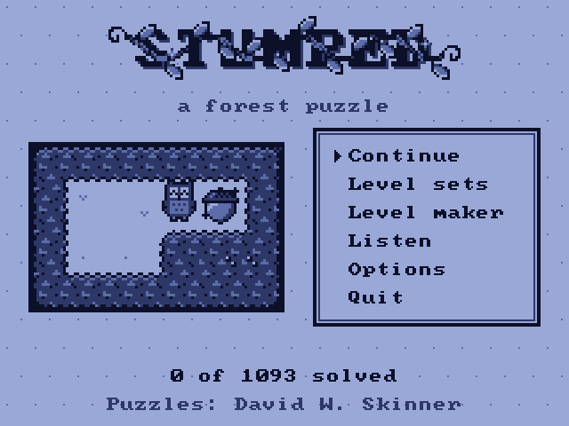
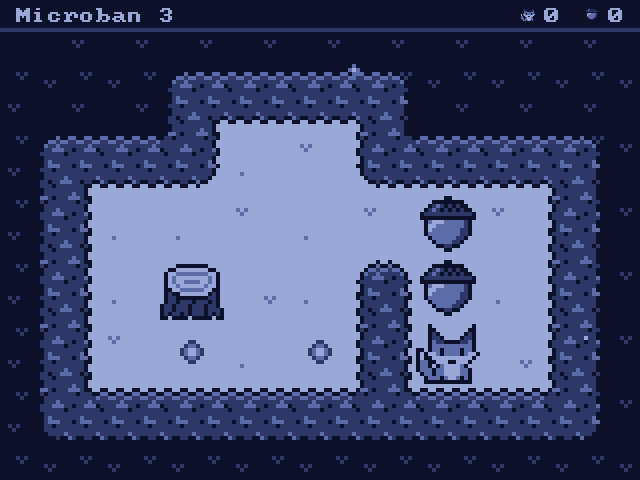

# Stumped

A Game Boy–style Sokoban set in a forest at night. Push the acorns onto their spots, on the
**Miyoo Mini / Mini Plus running Onion OS** or in your browser.

**[Play in your browser](https://reevehunter.com/stumped/)**

 

## Features

- **1,093 puzzles** by David W. Skinner, from gentle (Microban) to hard (Sasquatch), and 100 more of
  our own in **Wild Wood**
- **A level maker**, with codes (and QR codes) to share your levels
- **Progress codes** to carry your solved levels between devices
- Plays on the Miyoo and in any browser, with buttons, a keyboard, touch or a game controller

## Install on the Miyoo

Copy the `dist/Stumped` folder to `App/` on the SD card, then open **Stumped** from Apps.
Your progress is saved in `App/Stumped/save.txt`.

## Controls

| Button | In a level | In menus |
|---|---|---|
| D-pad | Walk and push | Move |
| A | Redo | Choose |
| B | Undo (hold to keep undoing) | Back |
| X (hold) | Restart | Next unsolved level |
| Y (hold) | Map of the whole level | |
| L1 / R1 (hold) | Previous / next level | Page |
| L2 / R2 | Zoom out / in | |
| Select | Level list | The set's menu |
| Start | Pause menu | |

In the browser, the prompts on screen change to match your keyboard, touch screen or controller.

## Building

See [docs/BUILDING.md](docs/BUILDING.md).

## Credits

- **Wild Wood**: generated for Stumped and chosen by hand; under the same licence as the game.
- **Puzzles: David W. Skinner** (Grandview, Washington, USA): Microban, Microban II–IV, Sasquatch,
  Sasquatch II–XII (Sasquatch as revised in 2010). *"These sets may be freely distributed provided they
  remain properly credited."* The text files come from the
  [Sokoban4J](https://github.com/medovina/Sokoban4J) collection, which publishes them with the author's
  permission.
- Sokoban was created by Hiroyuki Imabayashi; © 1982 Thinking Rabbit Inc.
- QR codes: [QR Code generator library](https://www.nayuki.io/page/qr-code-generator-library) by Project
  Nayuki (MIT licence).
- Font: [font8x8](https://github.com/dhepper/font8x8) by Daniel Hepper (public domain).
- The Onion launch setup is adapted from [OnionUI/Onion](https://github.com/OnionUI/Onion).

## Licence

The code and art are under the [MIT licence](LICENSE). The puzzles keep David W. Skinner's terms above.
